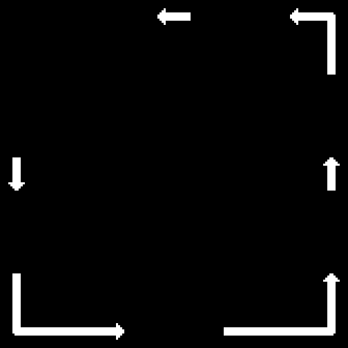
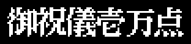

# Los textos

Ganbare Goemon! salió solo en japonés. Aquí están todos sus textos, sacados de la ROM con `tools/textos.py` (`make textos`), cada uno con su dirección, quién lo pide y una traducción. **La traducción es nuestra, no de Konami**, y no sale del parche de traducción al inglés de [MSX Translations](https://msxtranslations.com/goemon.php).

## Cómo se guardan

- **La fuente.** `letras_del_texto` (`p00:4A6D`) sube a la página 1 del VDP 0x91 letras de 1 bit desde `0x929D` (banco 14) y otras 10 desde `0x9725`. La letra c queda en x = (c mod 32) × 8, y = (c / 32) × 8 + 0x38 (`p00:491C`), así que la primera es la 0x20. Del 0x20 al 0x29 son las cifras, del 0x2A al 0x2F KONAMI, del 0x30 al 0x5D los hiragana en el orden del gojūon (あいうえお かきくけこ...), del 0x5E al 0x61 las pequeñas っゃゅょ, 0x62 y 0x63 las marcas ゜ y ゛ (van detrás de la letra y solo avanzan 4 puntos, `p00:490C`), del 0x64 al 0x6A la puntuación y 両 (ryō), y del 0x6B en adelante trozos de dibujo: letras grandes y marcos. No hay katakana ni kanji sueltos.
- **Los rótulos** se pintan de golpe (`rotulo`, `p00:48F3`): x, y y las letras; 0xFE cambia de posición y 0xFF acaba. Cada letra es una copia HMMM de 8 × 8 desde la página 1.
- **Los textos letra a letra** (`sigue_texto`, `p00:42F1`): 0xFE es renglón nuevo, 0xE0 + n deja n huecos y 0xFF acaba.
- **Los trozos del final** llevan delante cuántas letras tienen; `texto_del_final` (`p01:653C`) los junta en 0xD800 y se escriben letra a letra.

«…» en una traducción es un hueco en blanco del rótulo (en los dados, por ejemplo, ahí se pintan los dos números, `p03:B26D`). Los rótulos con dibujos van como imagen, pintados con las letras de la ROM en blanco sobre negro (en el juego salen del color de la paleta de cada pantalla).

## Quién pide cada rótulo

La tabla de `p12:A9C0` tiene 120 punteros; los seis últimos van a `0xB6D2`, donde acaban los rótulos, así que hay 114 (0x00-0x71). Los piden `rotulo_numero` (`p00:4280`) y `caja_y_texto` (`p03:B836`) con el número en A. En los bytes de la ROM hay 22 llamadas o saltos a 0x4280 y 18 a 0xB836, los mismos que el listado, y de todos se sabe el número que pasan: un `ld a` delante, una tabla o una cuenta.

- Los dos que no pide nadie son el **0x10**, que apunta al mismo texto que el 0x11, y el **0x17** («Señor, la tienda ha cerrado»); la tienda cerrada usa el 0x6F y el 0x70 (`p03:AD72`).
- Los del **0x20 al 0x65** los saca `texto_al_azar` (`p03:B75E`) en el interior 20: 0x20 más el anterior y un número de 0 a 15 sacado del registro R, dando la vuelta en 0x17; en 0x37 si se llevan las cosas 3 y 4 del marcador, y en 0x46 si además se lleva la 0x0A. Por eso salen primero las frases (0x20-0x36), luego los consejos en verso (0x37-0x56) y al final los que dicen las claves (0x57-0x65).
- En `p12:AFDE`, justo detrás del 0x34 y en la altura del renglón siguiente (y = 0x50), hay un trozo de rótulo, «である。», al que no apunta ningún puntero. El 0x34 acaba con 0xFF antes y se queda en tres renglones.
- Del 0x58 al 0x5E el final de los dos últimos renglones son letras que no forman palabras (se dejan sin traducir). No se ha mirado si esconden algo.

## Los rótulos del banco 1

El título, la pausa, la contraseña, el menú del vecino y el marcador. Los de 0x640F y 0x641D (el nombre de cada jugador con «はじまり») no los escribe nadie.

| | Japonés | Traducción | Lo pide |
|---|---|---|---|
| `p01:639B` | ◎KONAMI 1987 / どっちで あそびまっか? / ひとりで がんばる / ふたりで たのしむ | © KONAMI 1987 / ¿Cómo quieres jugar? / Uno solo, a darlo todo / Dos, a pasarlo bien | `p00:5B06`, `p00:5E5E` |
| `p01:63DB` |  | Se acabó | `p00:5FD2` |
| `p01:63E3` |  | F5 para continuar | `p00:5F9B`, `p00:5FDE` |
| `p01:636C` | いっぷく | Un respiro | `p01:6369` |
| `p01:628A` | あんごうは? | ¿La contraseña? | `p01:6284` |
| `p01:6CCC` | ひみつのあんごう | La contraseña secreta | `p01:6BDB` |
| `p01:7F41` | ーーーせんたくーーー / よなおし はじめる / くにの ばんごうを かえる / ごえもんのかずを かえる | — Elige — / Empezar a arreglar el mundo / Cambiar el número del país / Cambiar el número de Goemons | `p01:7F25` |
| `p01:7F94` | くにのばんごうは ? | ¿El número del país? | `p01:7F86` |
| `p01:7FB9` | ごえもんのかずは ? | ¿Cuántos Goemons? | `p01:7FA6` |
| `p01:642D` |  | Goemon | `p00:43EE` |
| `p01:6435` |  | Nezumi Kozō | `p00:43EE` |
| `p01:63F0` |  | Tiempo / Koban / ryo / Vida / Quedan | `p00:43F4` |
| `p01:640F` |  | Goemon: empieza | nadie |
| `p01:641D` |  | Nezumi Kozō: empieza | nadie |

## Los 114 rótulos de la tabla

Interiores: 0-15 tiendas, 16 la entrada al pasadizo secreto, 17 los dados, 18 la posada, 19 la casa de empeños que pide la carta del jefe, 20 el que da consejos.

| N.º | Japonés | Traducción | Lo pide |
|---|---|---|---|
| 0x00 `p12:AAB0` | はい  いいえ | Sí / No | `p02:92AA`, `p03:B122`, `p03:B1A4`, `p03:B56A`, `p03:B6D1` |
| 0x01 `p12:AABA` | ちょう はん | Par / Impar | `p03:B1DF` |
| 0x02 `p12:AAC3` | おきゃくさん おとまりかね | ¿Se queda a dormir, señor? | `p03:B369` |
| 0x03 `p12:AAD3` | どうちゅう おきをつけて | Buen viaje, vaya con cuidado | `p03:B52E` |
| 0x04 `p12:AAE3` | これっぽっちの おかねじゃ / とめるわけに いかないね | Con tan poco dinero / no puedo darle cama | `p03:B3E1` |
| 0x05 `p12:AB04` | にいさん ばくちは / やるかい | Joven, ¿te apetece / jugar? | `p03:B1A0` |
| 0x06 `p12:AB18` | さあ わかいの はってくれ | Venga, muchacho, apuesta | `p03:B1DA` |
| 0x07 `p12:AB28` |  | (tres renglones en blanco) | `p02:92AF`, `p03:B392`, `p03:B3CD`, `p03:B5C2` |
| 0x08 `p12:AB5B` | でました / …の で / もってけ どろぼう | Han salido / … y … / ¡llévatelo, ladrón! | `p03:B23C` |
| 0x09 `p12:AB7A` | でました / …の で / また きなはれ | Han salido / … y … / vuelve otro día | `p03:B24F` |
| 0x0A `p12:AB95` | ちょう | Par | `p03:B285` |
| 0x0B `p12:AB9B` | はん | Impar | `p03:B285` |
| 0x0C `p12:ABA0` |  | (flechas y esquinas de dibujo) | `p02:8125` |
| 0x0D `p12:ABF3` |  | (un marco de dibujo) | `p02:9B83` |
| 0x0E `p12:AC3D` |  | 御祝儀壱万点: propina de diez mil puntos (seis letras de 16 × 16) | `p03:BDBC` |
| 0x0F `p12:AC5B` | なにか おしえようか | ¿Quieres que te cuente algo? | `p03:B6C1`, `p03:B6DF` |
| 0x10 `p12:AC68` | これでおしまいだ / 両いただくぜ | Se acabó / me quedo con … ryo | nadie (el mismo texto que el 0x11) |
| 0x11 `p12:AC68` | これでおしまいだ / 両いただくぜ | Se acabó / me quedo con … ryo | `p03:B796` |
| 0x12 `p12:AC80` | わかいの どうした / また なにか ききたいのか | ¿Qué pasa, muchacho? / ¿Quieres preguntar algo más? | `p03:B6C1` |
| 0x13 `p12:AC9D` | わかいの しつこいぜ / ありがね おいて / でていきな | Muchacho, qué pesado / deja todo tu dinero / y lárgate | `p03:B6C1` |
| 0x14 `p12:ACC0` | わかいの なんども / おそれいった。 … の / てがみをもたせてやろう。 | Muchacho, tantas veces… / me rindo. La carta de … / te la doy. | `p03:B6C1` |
| 0x15 `p12:ACED` | かねがたりねえぜ / しんでもらうしかねえな | No te llega el dinero / tendrás que morir | `p03:B7BA` |
| 0x16 `p12:AD09` |  | (un renglón en blanco) | `p03:AF56`, `p03:B149`, `p03:B83C` |
| 0x17 `p12:AD1A` | おきゃくさん みせは / おわったよ | Señor, la tienda / ha cerrado | nadie |
| 0x18 `p12:AD2F` | …のてがみを / もって ないやつは / かえっとくれ | La carta de … / quien no la traiga / que se vaya | `p03:B1A9` |
| 0x19 `p12:AD52` | うちは しちや だす / なにか うりますか | Esto es una casa de empeños / ¿vende algo? | `p03:B127` |
| 0x1A `p12:AD6C` | ようが ないなら / でていっとくれ | Si no quiere nada / váyase | `p03:B044`, `p03:B154` |
| 0x1B `p12:AD83` | にいさん まいど / こんかい とくべつに / まきもの を あげよう | Gracias, joven / por esta vez / te regalo un pergamino | `p03:B077` |
| 0x1C `p12:ADAC` | おやぶん | ¡Jefe! | `p03:B1B7` |
| 0x1D `p12:ADB4` | ごかろう | Buen trabajo (ごかろう, así en la ROM) | `p03:B1B7` |
| 0x1E `p12:ADBC` | おやぶん | ¡Jefe! | `p03:B6FA` |
| 0x1F `p12:ADC4` | ごかろう | Buen trabajo (ごかろう, así en la ROM) | `p03:B6FA` |
| 0x20 `p12:ADCC` | なんじ じしんをしれ。 | Conócete a ti mismo. | `p03:B78D` |
| 0x21 `p12:ADDC` | てつがくは さいじょうの / おんがくなり。 | La filosofía es la música / más alta. | `p03:B78D` |
| 0x22 `p12:ADF8` | きぼうとは めざめている / ゆめ なり。 | La esperanza es un sueño / despierto. | `p03:B78D` |
| 0x23 `p12:AE12` | わたしは しょうりを / ぬすまない。 | Yo no robo / la victoria. | `p03:B78D` |
| 0x24 `p12:AE28` | しんの よっきゅう なくして / しんの まんぞくは ない。 | Sin verdadero deseo / no hay verdadera satisfacción. | `p03:B78D` |
| 0x25 `p12:AE4A` | いかりは いっときの / きょうき なり。 | La ira es una locura / pasajera. | `p03:B78D` |
| 0x26 `p12:AE62` | なんじ の きょうは / えいえん なり。 | Tu hoy / es eterno. | `p03:B78D` |
| 0x27 `p12:AE7B` | なくことも いっしゅの / かいらく なり。 | Llorar también es / una forma de placer. | `p03:B78D` |
| 0x28 `p12:AE94` | にんげんは / かんがえる あし / である。 | El hombre es / una caña que piensa. | `p03:B78D` |
| 0x29 `p12:AEB1` | てんさいとは / にんたいである。 | El genio / es paciencia. | `p03:B78D` |
| 0x2A `p12:AEC6` | こころは いっしゅの / げきじょうだ。 | La mente es / una especie de teatro. | `p03:B78D` |
| 0x2B `p12:AEE0` | てつがくの / だいいっぽは / ふしん にある。 | El primer paso / de la filosofía / es la duda. | `p03:B78D` |
| 0x2C `p12:AEFF` | わたしの えんを / みださないで ください。 | No me desordenes / los círculos. | `p03:B78D` |
| 0x2D `p12:AF1C` | しにん に ぐちなし。 | Los muertos no se quejan (juego con «los muertos no hablan»). | `p03:B78D` |
| 0x2E `p12:AF2B` | しらぬが とぼけ。 | Lo que no se sabe, se disimula (juego con «ojos que no ven…»). | `p03:B78D` |
| 0x2F `p12:AF39` | てもち ぶたさん。 | Manos vacías, señor cerdo (juego con «tener las manos ociosas»). | `p03:B78D` |
| 0x30 `p12:AF46` | こめだわら こうたろう。 | Saco de arroz Kōtarō. | `p03:B78D` |
| 0x31 `p12:AF56` | ありそで うっふん / なかそね あっはん。 | Parece que sí, uy / Nakasone, ah (juego con «parece que hay, pero no» y el primer ministro Nakasone). | `p03:B78D` |
| 0x32 `p12:AF70` | ぼくらはみんな / おきている。 / おきているから / ねむいんだ。 | Todos estamos / despiertos. / Como estamos despiertos / tenemos sueño (parodia de la canción «Bokura wa minna ikite iru»). | `p03:B78D` |
| 0x33 `p12:AF98` | たのしきと おもうが / たのしき しんずいなり。 | Creer que es divertido / es la esencia de la diversión. | `p03:B78D` |
| 0x34 `p12:AFB6` | げーむとは いきた / そうごうであり / いだいな たんじゅん | Un juego es una síntesis / viva y una / gran sencillez | `p03:B78D` |
| 0x35 `p12:AFE6` | わきあがる かんどうとは / こころと かんかくの いっち / である。 | La emoción que brota / es la unión del corazón y los sentidos. | `p03:B78D` |
| 0x36 `p12:B010` | せいしんてき には / あまちゅあ で / ぎじゅつてき には / ぷろであれ。 | De espíritu / aficionado / de técnica / profesional. | `p03:B78D` |
| 0x37 `p12:B040` | うみのはし / とべば / ひよりあり | Al borde del mar / si saltas / hace buen tiempo | `p03:B78D` |
| 0x38 `p12:B058` | どうちゅうの / げんきみなぎる / やどやかな | En el camino / te llena de fuerza / la posada | `p03:B78D` |
| 0x39 `p12:B077` | ちかつうろ / とおれぬいわに / きせるうち | Pasadizo subterráneo / a la roca que no deja pasar / golpe de kiseru | `p03:B78D` |
| 0x3A `p12:B091` | はりせんに / いわおもくだく / いりょくかな | El abanico harisen / rompe hasta las rocas / qué poder | `p03:B78D` |
| 0x3B `p12:B0AD` | いわくだき / かぶとがひかる / さっきばれ | Rompiendo rocas / brilla el casco / cielo de mayo | `p03:B78D` |
| 0x3C `p12:B0CB` | ときは かねなり / こばんは うなり | El tiempo es oro / koban a montones | `p03:B78D` |
| 0x3D `p12:B0E2` | いたづらや / すずめの ふんには / さんどがさ | Travesuras / contra la caca de gorrión / el sombrero de viaje | `p03:B78D` |
| 0x3E `p12:B102` | こめだわら / つぶされまいぞと / かぶとつけ | Sacos de arroz / para que no te aplasten / ponte el casco | `p03:B78D` |
| 0x3F `p12:B121` | まきものに / ひでん みつけて / こんてにゅう | En el pergamino / encontré el secreto / continuar | `p03:B78D` |
| 0x40 `p12:B13E` | ひょうたんで / たいりょく みなぎる / ふしぎかな | Con la calabaza / la vida rebosa / qué misterio | `p03:B78D` |
| 0x41 `p12:B15F` | ろうそくの / ひかりに ひかる / いりぐちや | A la luz / de la vela brilla / la entrada | `p03:B78D` |
| 0x42 `p12:B17B` | すなどけい / ときの ぴんちに / ちょうほうし | El reloj de arena / cuando falta tiempo / una joya | `p03:B78D` |
| 0x43 `p12:B199` | おまもりに / ひきゃくの あしの / とおのけり | Con el amuleto / los pasos del correo / se alejan | `p03:B78D` |
| 0x44 `p12:B1B5` | ひかえおろう / このいんろうは / むてきなり | ¡Atrás! / Este inrō / te hace invencible | `p03:B78D` |
| 0x45 `p12:B1D0` | ひなわじゅう / よろいが あれば / うれいなし | El arcabuz / con la armadura / no preocupa | `p03:B78D` |
| 0x46 `p12:B1EF` | ゆきどまり / きせるが ないてる / ちかつうろ | Callejón sin salida / llora la kiseru / pasadizo subterráneo | `p03:B78D` |
| 0x47 `p12:B20D` | うりぼうの / さんびきへたい / かわいいな | Los jabatos / escuadrón de tres / qué monos | `p03:B78D` |
| 0x48 `p12:B229` | いしがきに / あるはずなかろう / つうこうてがた | En el muro de piedra / no puede estar / el salvoconducto | `p03:B78D` |
| 0x49 `p12:B249` | てんかける / てんぐのはなに / こばんなげ | Volando por el cielo / a la nariz del tengu / tira koban | `p03:B78D` |
| 0x4A `p12:B266` | うっかりと / ひきゃくに とられる / てがみかな | Por descuido / el correo te quita / la carta | `p03:B78D` |
| 0x4B `p12:B284` | おやぶんの / てがみを いただく / ひきゃくかな | La carta / del jefe se la lleva / el correo | `p03:B78D` |
| 0x4C `p12:B2A4` | おやぶんの / てがみが なければ / よそのひと | Sin la carta / del jefe / eres un extraño | `p03:B78D` |
| 0x4D `p12:B2C4` | きをつけろ / おばばの ばくだん / いのちとり | Cuidado / la bomba de la abuela / es mortal | `p03:B78D` |
| 0x4E `p12:B2E4` | じょうほうや / おかね とられて / もらいなき | El informador / te quita el dinero / y lloras con él | `p03:B78D` |
| 0x4F `p12:B301` | じょうほうや / せいかく わかる / さんかいめ | El informador / acierta / a la tercera | `p03:B78D` |
| 0x50 `p12:B31E` | じょうほうや / せいかく わかる / てんの あるなし | El informador / acierta / si hay punto o no | `p03:B78D` |
| 0x51 `p12:B33E` | えれきがに / たいじの はやい / こばんなげ | Al cangrejo eléctrico / se le vence rápido / tirando koban | `p03:B78D` |
| 0x52 `p12:B35D` | とつぜんに / とびだす さかなに / おおおおお | De repente / salta un pez / ¡oooooh! | `p03:B78D` |
| 0x53 `p12:B37C` | こうげきに / びくともしない / こめだわら | A los golpes / ni se inmuta / el saco de arroz | `p03:B78D` |
| 0x54 `p12:B399` | がけのふち / うかつなうごき / いのちとり | Al borde del barranco / un paso en falso / es mortal | `p03:B78D` |
| 0x55 `p12:B3B5` | にかいめの / あいてむ かかくは / いんふれよ | La segunda vez / el precio del objeto / inflación | `p03:B78D` |
| 0x56 `p12:B3D1` | ちかのいわ / すぴーどあっぷで / さんことび | La roca del subterráneo / con más velocidad / salta tres | `p03:B78D` |
| 0x57 `p12:B3F1` | きゅうばーと / じゅうばい たのしむ / べんりさよ | Q*bert / diez veces más divertido / qué práctico | `p03:B78D` |
| 0x58 `p12:B413` | いつのひか / ゆくぞ ふりにむ / ねねくいあ | Algún día / ¡allá voy! ふりにむ / ねねくいあ | `p03:B78D` |
| 0x59 `p12:B42F` | あらふしぎ / いれて つほちね / くせわえお | ¡Qué misterio! / mete つほちね / くせわえお | `p03:B78D` |
| 0x5A `p12:B44B` | ごえもんに / べんり めをほゆ / ぬへすいう | Para Goemon / útil めをほゆ / ぬへすいう | `p03:B78D` |
| 0x5B `p12:B468` | とんでゆく / ふしぎ きちんけ / るあまうえ | Se va volando / misterio きちんけ / るあまうえ | `p03:B78D` |
| 0x5C `p12:B485` | あんごうの / ひみつ えせいけ / えわふえお | El secreto / de la contraseña えせいけ / えわふえお | `p03:B78D` |
| 0x5D `p12:B4A1` | うれしいわ / みりょくの のめとは / についいお | Qué alegría / el encanto のめとは / についいお | `p03:B78D` |
| 0x5E `p12:B4BE` | いっちゃった / すごい りいみり / めみたいた | Se fue / increíble りいみり / めみたいた | `p03:B78D` |
| 0x5F `p12:B4DB` | おやぶん は / めいろの ちずを / くれなはる | El jefe / el mapa del laberinto / te lo da | `p03:B78D` |
| 0x60 `p12:B4F9` | きみちゃんげんき で / ごえもん げんき | Con «kimichan genki» / Goemon en forma | `p03:B78D` |
| 0x61 `p12:B515` | あけみさんのさいふ には / にせんりょう | En la cartera de Akemi / hay dos mil ryo | `p03:B78D` |
| 0x62 `p12:B52D` | ねずみこぞうは / くるくるてん すぺーす / ですよ | Nezumi Kozō es / «kurukuru ten» y espacio / ¿sabes? | `p03:B78D` |
| 0x63 `p12:B54F` | こんてにゅう / つづきがしたい と / いのります | Continuar / «tsuzuki ga shitai» / rezo | `p03:B78D` |
| 0x64 `p12:B56E` | せんたくは / でぐちのみえる / さんかいめ | Para elegir / la salida se ve / a la tercera | `p03:B78D` |
| 0x65 `p12:B58A` | おみっちゃん / こばんもくれる / すきやねん | Omitchan / también te da koban / «sukiyanen» | `p03:B78D` |
| 0x66 `p12:B5A6` | わかいの どうした / まだ なにか ききたいのか | ¿Qué pasa, muchacho? / ¿Aún quieres preguntar algo? | `p03:B6C1` |
| 0x67 `p12:B5C4` | いらっしゃいませ / ひとつ どないですか | Bienvenido / ¿qué tal uno? | `p03:AEED` |
| 0x68 `p12:B5DE` | へい ようおこし | ¡Eh, bienvenido! | `p03:AEED` |
| 0x69 `p12:B5E9` | いつも にこにこ げんきん / ばらい | Siempre con una sonrisa, pago / al contado | `p03:AEED` |
| 0x6A `p12:B606` | にいさん まいど / なに さしあげましょ | Gracias, joven / ¿qué le pongo? | `p03:AEED` |
| 0x6B `p12:B620` | かねも もってねえのに / ふてえ やろうだ | Sin un duro / y con esa cara | `p03:AEED` |
| 0x6C `p12:B63A` | にいさん ふざけちゃこまるな | Joven, no me tomes el pelo | `p03:AEED` |
| 0x6D `p12:B64C` | かねもないのに みせに / くるんじゃないぜ | No vengas a la tienda / sin dinero | `p03:AEED` |
| 0x6E `p12:B667` | あんた おかねがたりないよ | Oiga, no le llega el dinero | `p03:AEED`, `p03:B5C2` |
| 0x6F `p12:B678` | にいさん みせはおわったよ | Joven, la tienda ha cerrado | `p03:AD72` |
| 0x70 `p12:B688` | またこんど みせのあいている / ときに きとくれ | Vuelve otro día / cuando la tienda esté abierta | `p03:AD72` |
| 0x71 `p12:B6A5` | にいさん … 両だせば / このおくの ひみつのつうろに / あんない しよう | Joven, si pagas … ryo / al pasadizo secreto de aquí detrás / te llevo | `p03:B56F` |
| — `p12:AFDE` | である。 | es. | nadie |

## Al pasar de zona

35 textos (`p15:BC16`), uno por zona, que `p02:962F` escribe letra a letra: el número es fase × 5 + zona − 1.

| N.º | Japonés | Traducción | Lo pide |
|---|---|---|---|
| 0 `p15:BC5C` | まずは ほんの こてしらべ | Para empezar, un tanteo | `p02:962F` |
| 1 `p15:BC6C` | つかって べんりな じょうほうや | El informador, muy útil si lo usas | `p02:962F` |
| 2 `p15:BC7F` | おまもりあると じょうほう ふえる | Con el amuleto hay más información | `p02:962F` |
| 3 `p15:BC92` | ねこに こばん ぶたに しんじゅ | Koban al gato, perlas al cerdo | `p02:962F` |
| 4 `p15:BCA6` | つぎは すてーじ6だ ゆけっ | ¡Ahora la fase 6, adelante! | `p02:962F` |
| 5 `p15:BCB8` | たんばささやま いのしし うまい | Tamba-Sasayama: el jabalí está rico | `p02:962F` |
| 6 `p15:BCCA` | かいばらこうこう わがぼこう | El instituto Kaibara, mi alma máter | `p02:962F` |
| 7 `p15:BCDC` | なんてったって あいどる だい | Digan lo que digan, soy un ídolo | `p02:962F` |
| 8 `p15:BCEE` | ゆけば ゆくほど おくがある | Cuanto más avanzas, más hay al fondo | `p02:962F` |
| 9 `p15:BD00` | つぎは すてーじ13だ それっ | ¡Ahora la fase 13, vamos! | `p02:962F` |
| 10 `p15:BD13` | たびは みちずれ よは なさけ | En el viaje, compañía; en la vida, compasión | `p02:962F` |
| 11 `p15:BD25` | のってきたきた あーこりゃこりゃ | ¡Ya me animo, ya! ¡Aah, korya korya! | `p02:962F` |
| 12 `p15:BD36` | ときめきの すてーじくりあ じゃ | ¡Una fase superada que acelera el corazón! | `p02:962F` |
| 13 `p15:BD49` | さかせて さかせて ももいろ するめ | Que florezca, que florezca: calamar seco rosa | `p02:962F` |
| 14 `p15:BD5C` | つぎは すてーじ20だ とおっ | ¡Ahora la fase 20, hop! | `p02:962F` |
| 15 `p15:BD6F` | やれば やるほど あじがでる | Cuanto más juegas, más gusto le coges | `p02:962F` |
| 16 `p15:BD83` | こなみの わーぷろ ぜんめんくりあ | El procesador de textos de Konami: borrado total | `p02:962F` |
| 17 `p15:BD97` | なんだ なんだ なんなんだ | ¿Qué es esto, qué es, qué demonios es? | `p02:962F` |
| 18 `p15:BDA8` | きあいを いれて それそれそれそれ | Con todas las ganas: ¡venga, venga, venga, venga! | `p02:962F` |
| 19 `p15:BDBA` | つぎは すてーじ27だ やあっ | ¡Ahora la fase 27, ya! | `p02:962F` |
| 20 `p15:BDCD` | なぞめく しかけに ちがさわぐ | Trampas misteriosas: me hierve la sangre | `p02:962F` |
| 21 `p15:BDE0` | ここらで すこし やすまんか | ¿Y si descansamos un poco aquí? | `p02:962F` |
| 22 `p15:BDF0` | すてーじくりあだ ほほいのほい | ¡Fase superada, hohoi no hoi! | `p02:962F` |
| 23 `p15:BE02` | つかって べんりな かくしこまんど | Las órdenes secretas, muy útiles si las usas | `p02:962F` |
| 24 `p15:BE16` | つぎは すてーじ34だ ほりゃ | ¡Ahora la fase 34, toma! | `p02:962F` |
| 25 `p15:BE29` | わはははは いっぽん とられましたな | ¡Ja, ja, ja, ja! Me has ganado un punto | `p02:962F` |
| 26 `p15:BE3D` | かくしこまんどは みつかったかな | ¿Has encontrado las órdenes secretas? | `p02:962F` |
| 27 `p15:BE4F` | きょだいな うめぼし まるかじり | Un umeboshi gigante, a mordiscos | `p02:962F` |
| 28 `p15:BE63` | たびゆかば いつかはあたる えどのまち | Si sigues viajando, algún día llegas a la ciudad de Edo | `p02:962F` |
| 29 `p15:BE7A` | つぎは すてーじ41だ たあっ | ¡Ahora la fase 41, ya! | `p02:962F` |
| 30 `p15:BE8D` | えどのまち いっきいっきで とっしんだ | La ciudad de Edo: ¡a la carga de un tirón! | `p02:962F` |
| 31 `p15:BEA4` | ここまでくれば あとは こんじょう | Llegados aquí, lo que queda es coraje | `p02:962F` |
| 32 `p15:BEB9` | かくしこまんど きみちゃんげんき | Orden secreta: «kimichan genki» | `p02:962F` |
| 33 `p15:BECC` | ここまでくれば あんたは ぷろよ | Si has llegado hasta aquí, eres un profesional | `p02:962F` |
| 34 `p15:BEE0` | つぎは えどじょう とつにゅうだ わおっ | ¡Ahora, al asalto del castillo de Edo, guau! | `p02:962F` |

## El señor de cada fase

Siete textos (`p02:9E0B`), uno por fase, que escribe `p02:9B9E`. En las fases 0 a 5, si se ha golpeado 8 veces o más a la figura de tipo 0x21 (0xCD60, `p03:A9D3`), sale en su lugar el de `p02:9F92` (ver [Hallazgos](HALLAZGOS.md)).

| N.º | Japonés | Traducción | Lo pide |
|---|---|---|---|
| 0 `p02:9E19` | おぬしの いわんと することは / よーく わかった。 こころ あらため / よい とのに なるぞ。 | Comprendo muy bien / lo que quieres decir. Me enmendaré / y seré un buen señor. | `p02:9B9E` |
| 1 `p02:9E49` | なるほど おぬしは えらい。 / みあげた もんじゃ。 ほうびに / たんばの ててうちぐりを とらせるぞ | Ya veo, eres admirable. / Digno de elogio. Como premio / te daré castañas de Tamba. | `p02:9B9E` |
| 2 `p02:9E82` | なるほどざ わるかったど。あやまる。 / ねんぐは ふやさん。ぼうえいひ も / けずる。 こうやく は まもるぞ。 | Ya veo, me equivoqué. Lo siento. / No subiré el tributo. El gasto en defensa / también lo recortaré. Cumpliré lo prometido. | `p02:9B9E` |
| 3 `p02:9EC0` | いまの おぬしのことばで / わしも めがさめた。 / おはよう なんちゃって。 | Tus palabras / me han abierto los ojos. / ¡Buenos días! Es broma. | `p02:9B9E` |
| 4 `p02:9EE8` | いままでのわしは いのなかの おかず / いや かわずで あった。 / もっとしょみんのためのせいじをするぞ。 | Hasta ahora yo era el guiso en el pozo, / digo, la rana en el pozo. / Gobernaré más para el pueblo. | `p02:9B9E` |
| 5 `p02:9F22` | しょみんの くるしみ よーく わかった。 / もう なにも いうでない。 / よい せいじを やくそく するぞ。 | Ahora entiendo el sufrimiento del pueblo. / No digas nada más. / Prometo gobernar bien. | `p02:9B9E` |
| 6 `p02:9F5A` | ひさしいのう。ついにここまできおったか / おぬしも せいちょうした。 / おぬしの しんげん ききいれようぞ。 | Cuánto tiempo. Por fin has llegado hasta aquí. / Has crecido. / Escucharé tu consejo. | `p02:9B9E` |
| — `p02:9F92` | おぬし わしのせいじにけちをつけるか。 / いい どきょうだ。 / つぎのすてーじ おぼえておくがいい。 | ¿Te atreves a criticar mi gobierno? / Qué valor. / Ya verás en la próxima fase. | `p02:9B9E` |

## El final

Siete trozos (`p12:BCD3`). `texto_del_final` (`p01:6546`) elige uno de cuatro finales por dos cosas: si el vecino (Q*bert o el Game Master) está en la otra ranura (0xEF00) y si se han pasado las 7 fases una a una (0xC26A = 7). Cada final es una lista de trozos (`p01:6589`).

| N.º | Japonés | Traducción | Lo pide |
|---|---|---|---|
| 0 `p12:BCE1` | おぬしは たいした ものよのう。 | Eres todo un personaje. | `p01:656B` |
| 1 `p12:BCF2` | おぬし よくやった。 / とりあえずは ほめて つかわす。 | Bien hecho. / Por ahora, te elogiaré. | `p01:656B` |
| 2 `p12:BD10` | これで よのなかも へいわとなり しょみんの / くらしも よくなるで あろう。 / しかし いつまた どこかで わるい とのさまが / あらわれるか わかりゃせん。 / そのときには ふたたび おぬしの かつやくに / しょみんの ねがいを たくすことに なろう。 | Con esto el mundo estará en paz y la vida / del pueblo mejorará. / Pero nunca se sabe cuándo ni dónde / aparecerá otro señor malvado. / Entonces el pueblo volverá a confiar / sus esperanzas en tus hazañas. | `p01:656B` |
| 3 `p12:BD98` | しかし すべての くにの とのさまが よい / せいじを やくそく してくれた わけでは ない。 / これでは すべての しょみんの くらしが よく / なったとは いいがたい。 / いまいちど しょこくに もどり ふたたび / よなおしを やってくれ。 / けんとうを いのっとるぞ。 | Pero no todos los señores de todos los países / han prometido gobernar bien. / Así no puede decirse que la vida de todo el pueblo / haya mejorado. / Vuelve una vez más a las provincias / y arregla el mundo otra vez. / Rezo por tu éxito. | `p01:656B` |
| 4 `p12:BE2E` | ごくろうであった。 あっぱれじゃ。 | Buen trabajo. ¡Espléndido! | `p01:656B` |
| 5 `p12:BE44` | ところで つぎにでる こなみの げーむは / ひのとり と まじょうでんせつ2 じゃ。 / よろしく たのむぞ。 | Por cierto, los próximos juegos de Konami / son Hinotori y Majō Densetsu II. / Contamos contigo. | `p01:656B` |
| 6 `p12:BE83` | ところで このつぎは 10ばいたのしむ かーと / りっじをつかわずに よなおしを やってほしい / ものよのう。 | Por cierto, la próxima vez me gustaría que arreglaras el mundo / sin usar el cartucho que lo hace diez veces / más divertido. | `p01:656B` |

| Final | Vecino | 7 fases | Trozos |
|---|---|---|---|
| 0 | no | no | 1, 3 |
| 1 | no | sí | 0, 2, 4, 5 |
| 2 | sí | no | 1, 3, 6 |
| 3 | sí | sí | 0, 2, 4, 6 |

## Las palabras secretas

Dos palabras de cinco letras que se teclean en la pausa (`p03:BE13`) y cuatro claves de nueve que acepta la pantalla de la contraseña (`p03:BE4E`); cada una pone un bit de 0xEF80. Lo que hacen está en [Hallazgos](HALLAZGOS.md).

| | Japonés | Traducción | Qué hace |
|---|---|---|---|
| `p03:BE44` | おやぶん | «Oyabun» (jefe) | dentro del pasadizo secreto: bit 0 y el mapa |
| `p03:BE49` | すきやねん | «Sukiyanen» (te quiero, en el habla de Kansai) | fuera: bit 1, +10 ryo con los tipos 8 y 0x21 |
| `p03:BE8A` | くるくるてんてん | «Kurukuru tenten» | bit 2: jugar con el jugador 2 |
| `p03:BE93` | きみちやんげんき | «Kimichan genki» (Kimi-chan, en forma) | bit 3: vida máxima 0x20 |
| `p03:BE9C` | あけみさんのさいふ | «Akemi-san no saifu» (la cartera de Akemi) | bit 4: 2000 ryo |
| `p03:BEA5` | つづきがしたい | «Tsuzuki ga shitai» (quiero seguir) | bit 5: continuar |
